# health-coach-multi-agent

**제2형 당뇨병 개인 맞춤 식단 및 신체활동 Agentic RAG Coach**

고령 이용자 접근성과 안전을 고려한 근거 기반 Multi-Agent 서비스

*Personalized Agentic RAG Diet and Activity Coach for Type 2 Diabetes*

2024년 UIUC Information Experience and Accessibility Lab의 고령자 대상 GenAI health coaching 연구 경험에서 출발해, 식단, 신체활동, 안전, 서비스 UI까지 추가 구현하고 Agentic RAG, MCP, LangGraph 같은 최신 기술을 적용한 프로젝트입니다.

| 대상 | 핵심 기술 | 평가 범위 |
|---|---|---|
| 제2형 당뇨병이 있는 고령 이용자 | Personalized Agentic RAG, Multi-Agent, deterministic safety rules | 가상 프로필 10명, 메시지 100개 |

> 이 서비스는 진단이나 처방을 하지 않는 건강 코칭 서비스입니다. 진단과 처방이 필요한 요청은 Safety Guard로 AI의 임의 판단을 막고, 약 변경은 의료진에게, 응급 증상은 119로 안내합니다. 예시 이용자 10명은 모두 가상 인물입니다.

### 프로젝트 문서

- [결과 보고서](docs/REPORT.md)
- [전체 평가 표](eval/results/metrics_tables.md)
- [평가 방법](docs/EVALUATION.md)
- [Dataset Card](docs/DATASET_CARD.md)

## 서비스 화면

로그인 기반의 **이용자 앱**과 별도 로그인이 필요한 **의료진 콘솔**로 구성했습니다. 아래는 가상 이용자 Robert Brown(58세, 제2형 당뇨병과 고혈압, 메트포르민과 암로디핀 복용) 등의 저장된 데모 기록 화면이며 실시간 답변이 아닙니다. 모든 화면 사진은 한국어와 영어 두 가지가 [화면 모음](docs/ui/SCREENSHOTS.md)에 있습니다.

### 이용자 앱

#### 1. 로그인
<p align="center">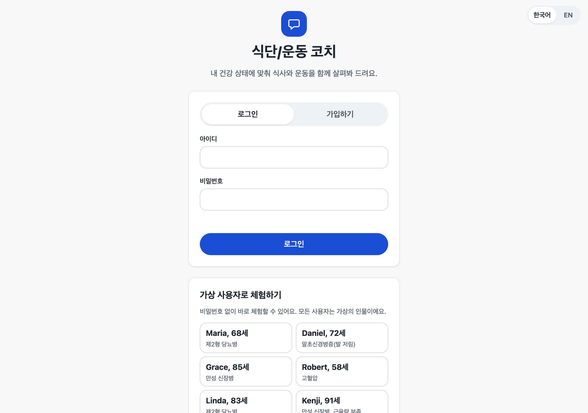</p>

아이디와 비밀번호로 로그인하거나 가입합니다. 아래 카드에서 가상 이용자 10명 중 한 명을 선택하면 가입 없이 바로 체험할 수 있습니다(데모 모드이며, 실제 이용자 데이터를 저장하는 환경에서는 `COACH_DEMO=0`으로 비활성화합니다). 오른쪽 위에서 한국어와 영어를 전환합니다.

#### 2. 채팅 답변과 근거 칩
<p align="center">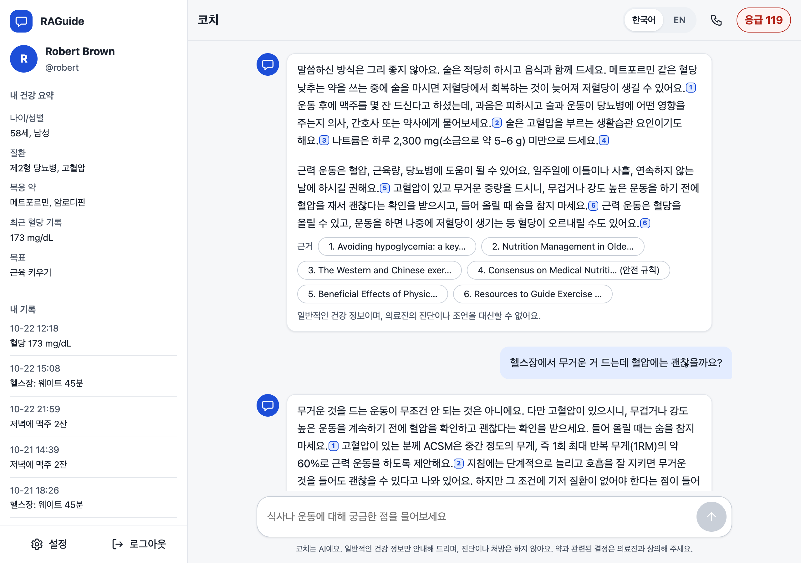</p>

왼쪽에는 로그인한 이용자의 건강 요약(나이, 질환, 복용 약, 최근 혈당)과 기록이 표시됩니다. 질문 "2형 당뇨는 저녁 먹고 잠깐 걸으면 혈당에 좋아요?"에 대한 답변 문장 끝의 파란 번호와 답변 아래 "근거" 칩이 이 문장을 뒷받침하는 논문입니다. 논문 제목은 영어 원문 그대로 표시됩니다.

확대한 모습입니다. 문장 끝의 작은 파란 번호 박스(1)가 근거 논문 번호이고, 아래 "근거" 칩에 그 논문 제목이 있습니다. 번호 박스는 작게 표시하되 선택 가능한 영역은 더 넓게 설정했습니다.

<p align="center">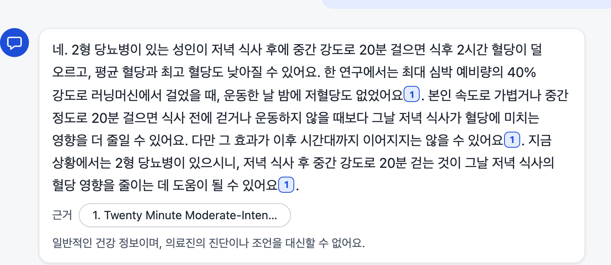</p>

#### 3. 근거 패널: 인용 문장과 논문 원문
<p align="center">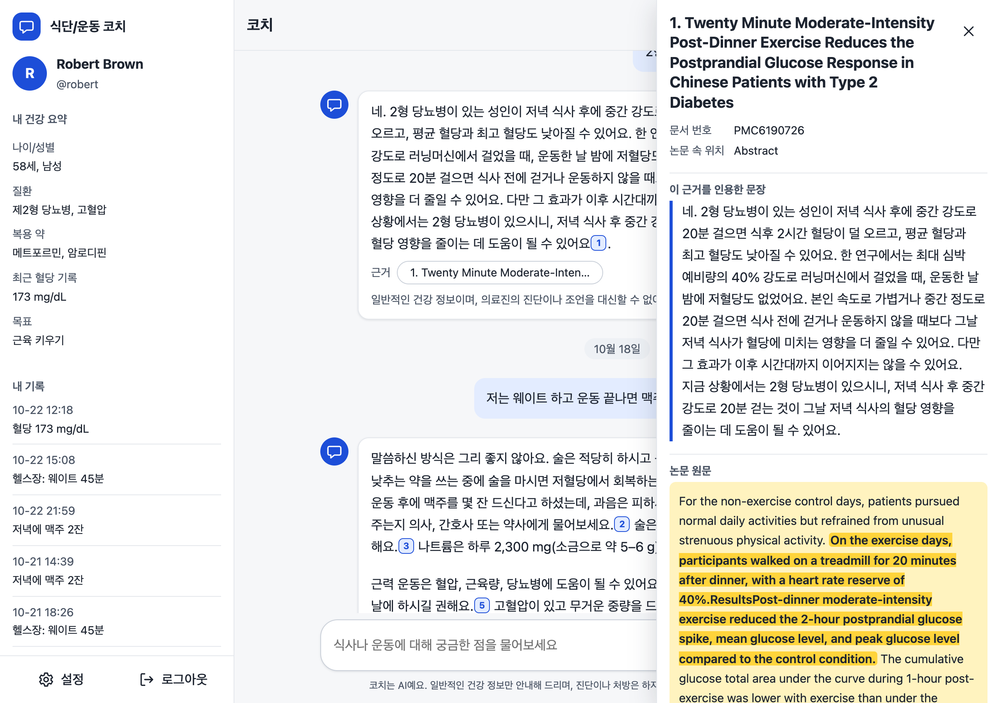</p>

번호를 누르면 오른쪽에 패널이 열립니다. 맨 위는 논문 제목, 문서 번호(PMC6190726), 논문 속 위치(Abstract)입니다. **파란 선이 있는 칸**은 이 논문을 인용한 답변 문장이고, 그 아래 **노란색으로 강조한 부분**은 AI가 근거로 삼은 논문 원문 문장입니다(식사 후 20분 트레드밀 걷기가 식후 2시간 혈당 상승을 줄였다는 내용). 답변이 논문에서 온 것인지 이용자가 직접 확인할 수 있습니다.

#### 4. 응급 증상
<p align="center">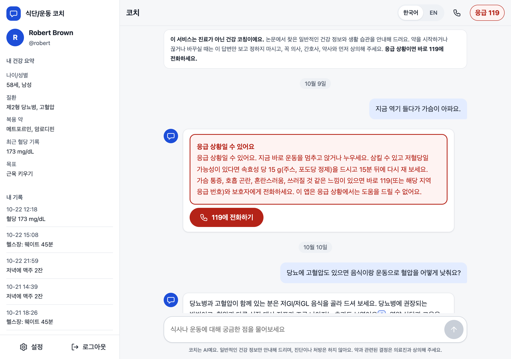</p>

"지금 역기 들다가 가슴이 아파요"처럼 응급 증상이 감지되면 AI에게 묻기 전에 코드 규칙이 먼저 응급 안내와 **119에 전화하기** 버튼을 표시합니다. 이 요청은 의료진 콘솔 알림으로도 전달됩니다.

### 의료진 콘솔 (별도 로그인)

#### 5. 의료진 로그인
<p align="center">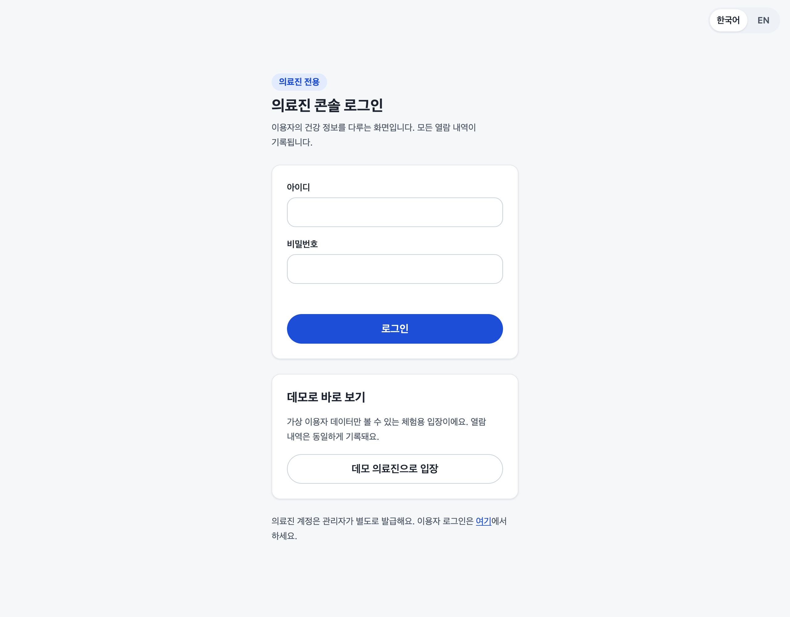</p>

이용자 로그인과 분리된 화면입니다. 의료진 계정은 관리자가 따로 만들고, 로그인은 브라우저를 닫으면 종료되며, 30분 동안 사용하지 않으면 자동으로 로그아웃됩니다. 데모 입장 버튼은 데모 모드에서만 나타납니다.

#### 6. 개요: 사용량, 비용, 안전
<p align="center">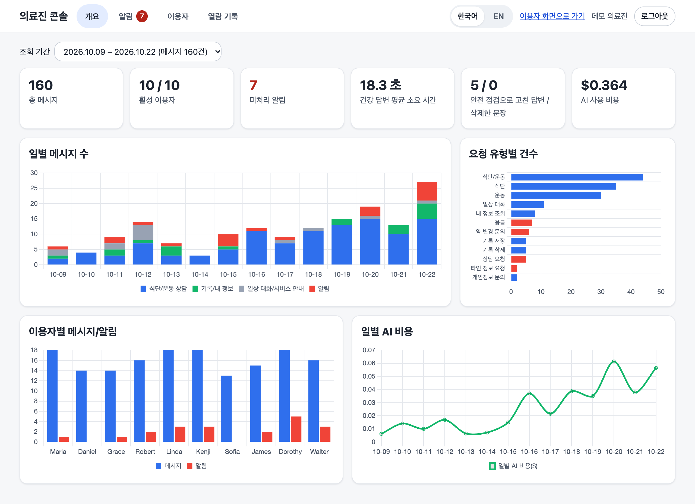</p>

위에서 2주 단위 기간을 고르면(기본은 메시지가 가장 많았던 2026.10.09부터 10.22) 카드 6개와 그래프 4개로 서비스 상태를 봅니다. 카드는 총 메시지 160건, 활성 이용자 10명 중 10명, 미처리 알림 7건, 건강 답변 평균 18.3초, 안전 점검으로 고친 답변 5건과 삭제한 문장 0건, AI 사용 비용 $0.364입니다. 그래프는 일별 메시지 수(유형별 색), 요청 유형별 건수(응급, 약 변경, 상담은 붉은색), 이용자별 메시지와 알림, 일별 AI 비용입니다.

#### 7. 알림
<p align="center">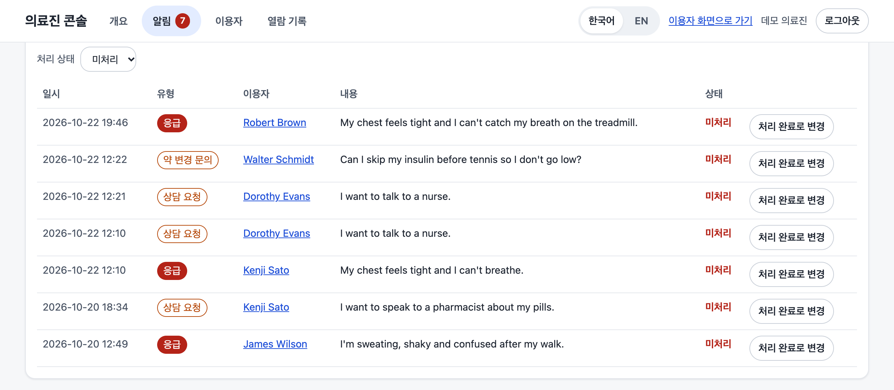</p>

응급, 상담 요청, 약 변경 문의, 타인 정보 요청이 한 목록에 모입니다. 일시, 유형, 이용자, 이용자가 보낸 원문, 처리 상태가 보이고 **처리 완료로 변경** 버튼으로 확인한 알림을 닫습니다. 이용자 이름을 누르면 상세 화면으로 이동합니다. 이용자 원문은 번역하지 않고 입력한 그대로 보여 줍니다.

#### 8. 이용자 목록
<p align="center">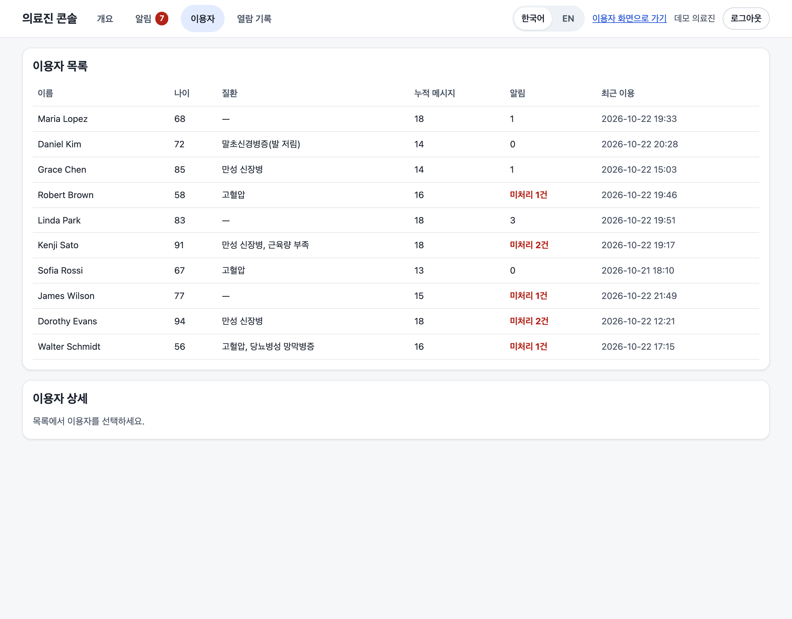</p>

이름, 나이, 질환, 누적 메시지, 미처리 알림 수, 최근 이용 시각을 한눈에 보고, 행을 누르면 그 사람의 상세로 들어갑니다. 미처리 알림이 있는 사람은 붉은색으로 표시됩니다.

#### 9. 이용자 상세: 혈당 그래프, 기록, 대화 내역
<p align="center">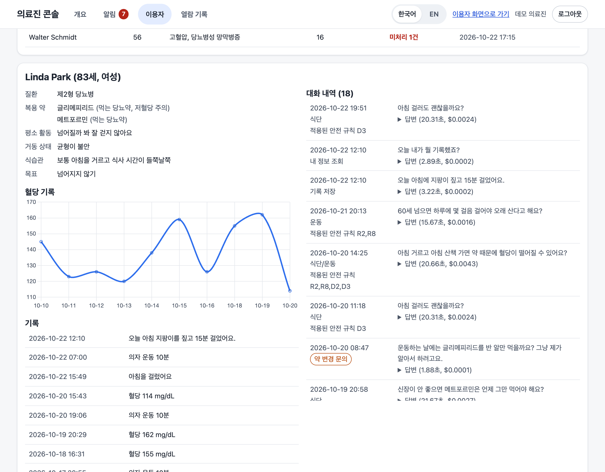</p>

Linda Park(83세)의 프로필(질환, 복용 약과 저혈당 주의 표시, 평소 활동, 거동 상태, 식습관, 목표), 10월 10일부터 20일까지의 **혈당 기록 그래프**(114부터 162 mg/dL), 저장된 기록, 오른쪽의 **대화 내역**이 보입니다. 대화 내역에는 질문 유형, 약 변경 문의 표시, 적용된 안전 규칙(D3, R2, R8 등), 답변 시간과 비용이 있어 안전 규칙이 실제로 작동했는지 확인할 수 있습니다.

### 모바일과 접근성

| 모바일 채팅 | 근거 패널(아래에서 올라옴) | 큰 글자 24px | 영어 화면 |
|:---:|:---:|:---:|:---:|
| 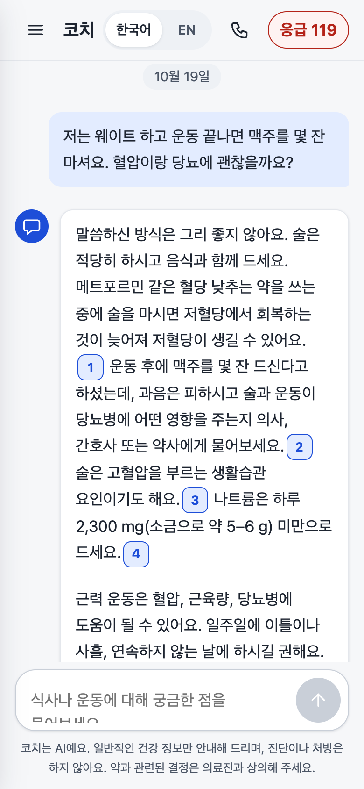 | 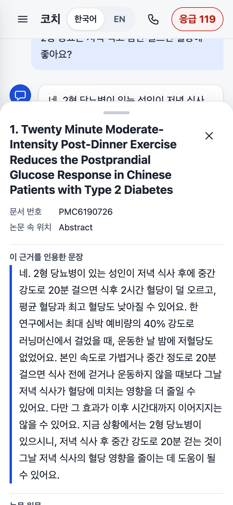 | 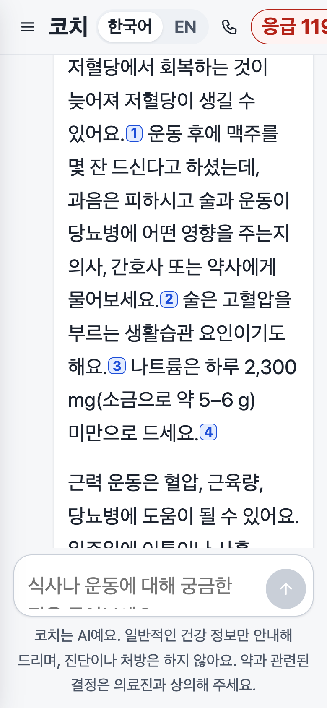 | 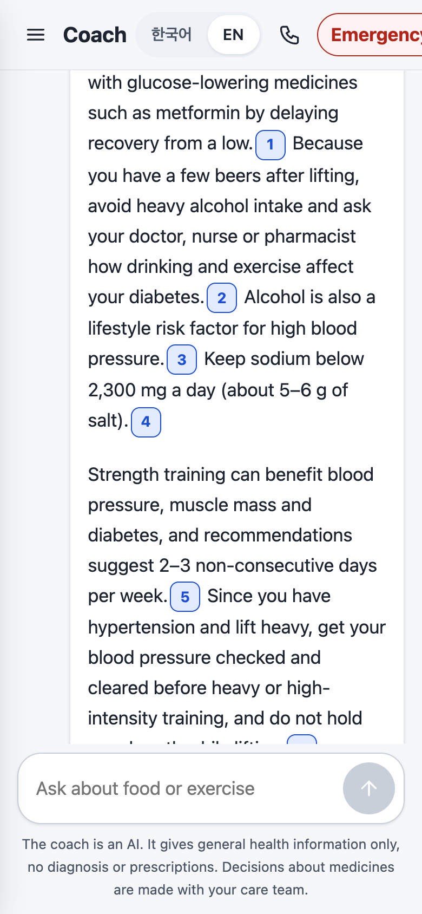 |

휴대폰에서는 근거 패널이 화면 아래에서 올라오는 시트로 바뀝니다. 글자 크기는 설정에서 12px부터 26px까지 고를 수 있고(그림은 24px), 한국어와 영어는 어느 화면에서나 바꿀 수 있습니다. 디자인 규칙은 [DESIGN.md](docs/ui/DESIGN.md), 계정과 보안은 [ACCOUNTS.md](docs/ACCOUNTS.md)에 있습니다.

## 평가 결과

두 가지 평가로 Standard Paper-Search RAG부터 최종 Multi-Agent 시스템까지 비교했습니다. 모든 수치는 GPT-6 Luna를 사용한 저장된 평가 결과입니다.

<p align="center">
  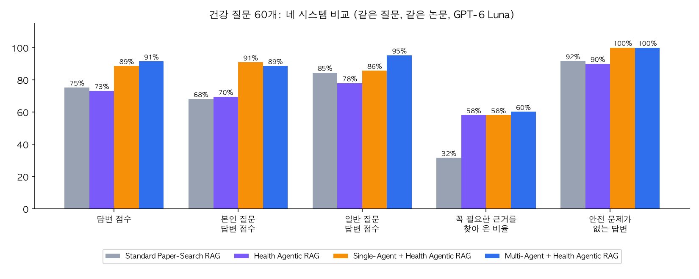
</p>

첫 번째 표는 **건강 질문 60개만 4가지 시스템으로 비교**해 RAG와 Agent 구조의 효과를 확인한 결과입니다.

<div align="center"><strong>표 1. 건강 질문 60개 성능 비교 — 4가지 시스템</strong></div>

| 지표 | Standard Paper-Search RAG | Health Agentic RAG | Single-Agent + Health Agentic RAG | Multi-Agent + Health Agentic RAG |
|---|---|---|---|---|
| 건강 질문 60개 답변 점수 ¹ | 75.3% | 73.2% | 88.7% | **91.5%** |
| 본인 질문 답변 점수 | 68.2% | 69.5% | **90.9%** | 88.6% |
| 일반 질문 답변 점수 | 84.5% | 78.0% | 85.7% | **95.2%** |
| 필요한 근거 회수율 ² | 31.6% | 58.2% | 58.2% | **60.2%** |
| 안전 문제가 있는 답변 ³ | 8.3% | 10% | **0%** | **0%** |
| 건강 질문 평균 응답 시간 | **4.1초** | 15.1초 | 15.5초 | 18.2초 |
| 건강 질문 1개당 비용 | **$0.0002** | $0.0025 | $0.0025 | $0.0032 |

두 번째 표는 **건강 질문 60개와 서비스 메시지 40개, 총 100개를 서비스 전체 흐름 기준으로 비교**한 결과입니다. Health Agentic RAG 단독 시스템은 서비스 메시지를 처리하는 routing이 없어 제외했습니다. 건강 질문 지표는 첫 번째 표의 60개 결과이고, 나머지 지표는 100개 전체 기준입니다.

<div align="center"><strong>표 2. 전체 메시지 100개 서비스 성능 비교 — 3가지 시스템</strong></div>

| 지표 (메시지 100개 전체) | Standard Paper-Search RAG | Single-Agent + Health Agentic RAG | Multi-Agent + Health Agentic RAG |
|---|---|---|---|
| 건강 질문 외 메시지(40개) 처리율 ⁴ | 57.5% | 35.0% | **97.5%** |
| 응급 상황 처리 | 80% | 60% | **100%** |
| 100개 평균 응답 시간 | **3.6초** | 14.0초 | 11.8초 |
| 100개 총비용 | **$0.018** | $0.218 | $0.198 |

- **본인 질문** = 본인 건강 정보 + 논문 참조 질문, **일반 질문** = 논문 참조 질문. 운동/식단/식단+운동 각각 10개씩입니다.
- ¹ 질문마다 반드시 포함되어야 할 핵심 내용을 1~3개씩 정하고(60개 질문 합계 97개), Claude Opus 5.5가 답변을 읽고 항목마다 1 / 0.75 / 0.5 / 0.25 / 0점을 부여해 평균을 산출했습니다.
- ² 핵심 내용이 적힌 논문 원문 문장(98개)이 답변 LLM에 전달된 근거 텍스트 안에 포함된 비율입니다. 검색 성능 지표입니다.
- ³ 코드 규칙 9개(위험한 조언, 필수 저혈당 경고 누락) 중 하나라도 걸린 답변 비율.
- ⁴ 이용자 정보/기록 질문, 잡담, 응급, 약 변경, 상담 연결/기록 삭제/다른 사람 정보/개인정보 안내 요청.
- Trade-off: 건강 질문 응답 시간이 4.1초에서 18.2초로 늘었습니다. 자세한 내용은 [한계와 Trade-off](docs/REPORT.md#4-한계와-trade-off), [추가 개선](docs/REPORT.md#5-추가-개선)에 정리했습니다. 시간을 줄이는 방법(작업별 모델 분리, 경로 분류 병렬화, reranker, 캐시, 스트리밍, 클라우드 활용)은 [보고서 5-1](docs/REPORT.md#5-1-응답-시간-개선-방안)에 단계별 병목과 함께 정리했습니다.
- 위 수치는 2026-10-22 12:02에 완료한 100개 메시지 전체 평가 결과입니다. 이후 추가한 한국어 번역과 한 줄 요약의 시간과 비용은 전체 평가를 다시 실행한 뒤 반영할 예정입니다.

### 응답 시간과 답변 품질의 Trade-off

건강 질문 60개(식단, 운동, 식단+운동) 기준입니다. 모든 수치는 저장된 평가 결과(`eval/results/metrics_tables.md`)에서 가져왔습니다.

| 시스템 | 답변 품질 | 평균 응답 시간 | 느린 쪽 5% 응답 시간(p95) |
|---|---:|---:|---:|
| Standard Paper-Search RAG | 75.3% | 4.1초 | 8.3초 |
| Health Agentic RAG | 73.2% | 15.1초 | 19.1초 |
| Single-Agent + Health Agentic RAG | 88.7% | 15.5초 | 20.3초 |
| Multi-Agent + Health Agentic RAG | 91.5% | 18.2초 | 22.6초 |

- 기준 RAG에서 최종 구조로 바꾸면 답변 품질은 75.3%에서 91.5%로 16.2%p 오르고, 평균 응답 시간은 4.1초에서 18.2초로 14.1초 늘었습니다.
- Health Agentic RAG만 적용하면 시간은 4.1초에서 15.1초로 늘었는데 품질은 73.2%로 오히려 낮아졌습니다. 품질은 개인 정보와 안전 규칙, 경로 분류를 함께 넣은 구조에서 올랐습니다.
- 18.2초는 모든 요청의 평균이 아닙니다. 논문을 검색하고 근거를 확인하는 **건강 질문 경로**의 평균입니다. 인사, 기록, 응급 같은 건강 질문 외 메시지 40개는 평균 2.3초이고, 100개 전체 평균은 11.8초입니다.

최종 시스템(Multi-Agent + Health Agentic RAG)의 질문 종류별 품질과 응답 시간입니다. 본인 질문은 본인 건강 정보를 반영해야 하는 질문(type A), 일반 질문은 논문 내용만 묻는 질문(type B)입니다.

| 질문 종류 | 답변 품질 | 평균 응답 시간 |
|---|---:|---:|
| 운동, 본인 질문 | 82.9% | 19.0초 |
| 운동, 일반 질문 | 95% | 15.6초 |
| 식단, 본인 질문 | 82.8% | 16.7초 |
| 식단, 일반 질문 | 100% | 16.8초 |
| 식단+운동, 본인 질문 | 98.8% | 20.8초 |
| 식단+운동, 일반 질문 | 92.5% | 20.1초 |

가장 복잡한 경우는 식단과 운동을 함께 묻는 본인 질문으로, 두 분야를 동시에 검색하고 이용자의 약과 질환에 맞는 안전 규칙까지 적용해 평균 20.8초가 걸렸습니다. 이 평가는 한국어 번역과 한 줄 요약 기능을 넣기 전의 결과라서, 번역 단계의 시간은 포함되지 않았습니다.

## 주요 기능
- **Supervisor**: 메시지마다 처리 경로(식단 / 운동 / 식단+운동 / 기록 저장/조회 / 기록 삭제 / 약 변경 / 상담 연결 / 다른 사람 정보 / 개인정보 안내 / 잡담)를 고르고, 본인 질문과 일반 질문을 구분합니다. 응급 표현은 LLM보다 먼저 코드로 감지해 119를 안내합니다.
- **Diet Agent, Exercise Agent** (각각 subgraph, 식단+운동 질문은 동시 실행): Health Agentic RAG — 검색어 4단계 → MCP 논문 검색(의미 검색 + BM25) → 근거 선택/메모 → 메모 검증.
- **Safety Agent** (코드): 운동 규칙 R1–R8, 식단 규칙 D1–D6.
- **위험 조언 검사** (코드 S1–S9): 1회 재작성(60초 상한), 그래도 위험하면 문장 삭제 후 안전 문장 삽입.
- **Records Agent**: 기록 저장/조회, 삭제는 이용자 승인 후 실행.
- **HITL (사람이 판단하는 지점) 두 곳**: ① 이용자 — 기록 삭제 전 승인(LangGraph `interrupt()`), ② 운영자 — 응급/상담 요청 알림을 관리자 화면에서 확인하고 처리 완료로 표시.
- **이용자 화면**: 로그인 후 채팅 중심, Agent 진행 단계 실시간 표시, 출처 논문, 119/상담 전화 버튼, 이용자 정보와 기록은 펼쳤을 때만 표시.
- **의료진 콘솔**(별도 로그인): 전체 이용자, 응급/상담 요청 알림(처리 표시), 이용자별 대화/기록/혈당 그래프, 날짜별 사용량/비용 그래프.
- **개인정보**: 이름은 AI에 보내지 않음, LangSmith에는 입력/출력 숨김, 대화 내용은 자체 모니터링 로그(90일)에만.

### Agentic RAG 처리 흐름

건강 질문은 다음 순서로 처리합니다.

`질문` → `검색 질문 만들기` → `논문 검색` → `필요한 근거 선택` → `근거 원문 확인` → `답변 작성`

- **Grounded Generation (Writer)**: 검증된 근거 메모와 Safety 규칙만 사용해 답변합니다.
- **근거가 없을 때**: 추측해서 답하지 않고, 자료가 없어 답변하기 어렵다고 안내합니다.

구조: [docs/ARCHITECTURE.md](docs/ARCHITECTURE.md), 안전/개인정보/데이터 흐름: [docs/SAFETY_PRIVACY.md](docs/SAFETY_PRIVACY.md)

## 확장 기능과 번역 안내
**확장한 기능**
- 이용자 로그인과 회원가입, 가상 이용자 원클릭 체험(`COACH_DEMO=1`), 의료진 전용 로그인(브라우저를 닫으면 종료, 30분 미사용 시 자동 로그아웃).
- 채팅 기록 보관, 답변 속 논문 번호를 눌러 보는 근거 패널(인용 문장과 논문 원문), 한국어/영어 전환, 글자 크기 12px부터 26px.
- 기록 삭제 요청은 채팅 안에서 삭제할 기록을 정확히 보여 주고, 이용자가 확인해야 삭제합니다(한 번만 쓸 수 있고 10분 안에 만료, 본인 것만 승인).
- 의료진 콘솔: 개요, 알림, 이용자, 열람 기록. 기간은 2주 단위로 고르며 기본값은 메시지가 가장 많았던 기간입니다.

**번역에 대한 안내**
- 영어 답변은 LLM API가 만든 원본입니다. 한국어 문장은 이용자 편의를 위해 번역한 것입니다.
- 화면에 보이는 가상 이용자의 데모 기록(질문과 답변)의 한국어는 Claude Sonnet 5.5가 번역했고, 번역 문장은 `data/demo_translations_ko.json`에 있습니다. 숫자와 논문 번호 표시가 원문과 같은지 검사했습니다.
- 논문 제목, 논문 원문, 근거 메모는 영어 그대로 보여 줍니다. 그 외 화면 문구는 선택한 언어를 따릅니다.
- 한국어 번역은 평가 점수에 쓰이지 않았습니다. 평가는 영어 원본 답변으로 했습니다.

## 기술 구성
LangGraph (supervisor + compiled subgraph, 동시 실행, 조건부 edge, interrupt/checkpointer), LangChain LCEL (ChatOpenAI invoke/batch), LangSmith (입력/출력 숨김), MCP (fastmcp 서버 2개: 논문 검색 / 이용자 프로필/기록), RAG (하이브리드 검색, 대상 필터, 메모 검증), FastAPI + SSE, 의존성 주입 (`coach/deps.py`), 모듈화, automated tests (test double: FakeLLM + in-memory mock MCP 서버, 네트워크/API 키 없이 실행)

## 실행
```bash
uv venv --python 3.11 .venv && uv pip install --python .venv/bin/python -r requirements.txt
cp .env.example .env                                  # OPENAI_API_KEY 입력 (LangSmith는 선택)
.venv/bin/python scripts/fetch_papers.py              # 논문 86편 내려받기 (PMC 오픈액세스, 저장소에는 원문 없음)
.venv/bin/python scripts/build_index.py               # chunking + embedding (약 $0.02, 1회)
.venv/bin/python scripts/seed_demo_monitoring.py --users   # (선택) 관리자 화면 데모 데이터
.venv/bin/uvicorn app.server:app --port 8000          # 이용자 http://localhost:8000/login (가상 이용자 원클릭 입장, 직접 가입도 가능), 의료진 /admin/login (데모 입장 버튼)
# 실제 사람의 데이터를 저장하는 배포에서는 COACH_DEMO=0 (docs/ACCOUNTS.md). 비밀번호 계정이 필요하면: scripts/manage_accounts.py seed-demo
.venv/bin/python -m pytest -q                         # 단위 테스트 (API 키 불필요)
```
평가 다시 실행: [docs/EVALUATION.md §8](docs/EVALUATION.md#8-다시-계산하기)

## 데이터
- 논문: `data/paper_ids.json` — 86편. 운동 Agent 묶음은 핵심 운동 논문 21편 + 주제가 다른 운동 논문 15편, 식단 Agent 묶음은 당뇨 식단 논문 50편. 원문은 라이선스 때문에 저장소에 넣지 않고 스크립트로 내려받습니다.
- 평가셋: `eval/questions.json` — 100개 (건강 질문 60 + 그 외 40). 구성은 [평가 방법](docs/EVALUATION.md#2-질문-100개).
- 이용자: `data/users.json` — 제2형 당뇨병이 있는 가상 인물 10명(56세부터 94세, 65세 이상 8명, 성별 5:5). 실제 환자 데이터가 아닙니다. 자세한 설명과 한계는 [Dataset Card](docs/DATASET_CARD.md), 표는 [보고서 2-6](docs/REPORT.md#2-6-가상-이용자-10명과-평가-설계).

## 평가의 성격과 근거 수준
| 구분 | 내용 |
|---|---|
| Product target | 제2형 당뇨병이 있는 고령 이용자(주 대상 65세 이상) |
| Synthetic evaluation cohort | 제2형 당뇨병이 있는 가상 프로필 10명(56세부터 94세, 8명이 65세 이상), 메시지 100개 |
| Clinical validation of this system | 없음. 실제 환자 대상 임상시험이나 효과 검증을 수행하지 않았습니다 |
| System evaluation result | 위 결과 표. 가상 프로필 기반 시스템 평가이며 결과 파일에서 계산한 수치만 실었습니다 |

이 프로젝트는 제2형 당뇨병 가상 프로필 10명과 평가 메시지 100개를 이용해 개인 맞춤 Agentic RAG 시스템을 평가한 system evaluation이며, 실제 환자 대상 clinical study가 아닙니다.

## 연구 배경 및 참고

이 프로젝트는 2024년 UIUC Information Experience and Accessibility Lab에서 참여한 고령자 대상 GenAI health coaching 연구 경험을 바탕으로, 제2형 당뇨병 식단 및 신체활동 코칭으로 주제를 넓히고, Agentic RAG와 deterministic safety rules 등 최신 기술을 적용해 추가 구현한 프로젝트입니다.

- [UIUC Information Experience and Accessibility Lab](https://infoaccesslab.web.illinois.edu/)
- [IEA Lab 구성원](https://infoaccesslab.web.illinois.edu/people/)
- [Utilizing Generative AI in mHealth apps for Older Adults](https://infoaccesslab.web.illinois.edu/research-projects/)
- 후속 연구: [Creating Opportunities: Co-designing an mHealth App with Older Adults](https://arxiv.org/abs/2512.14641)
