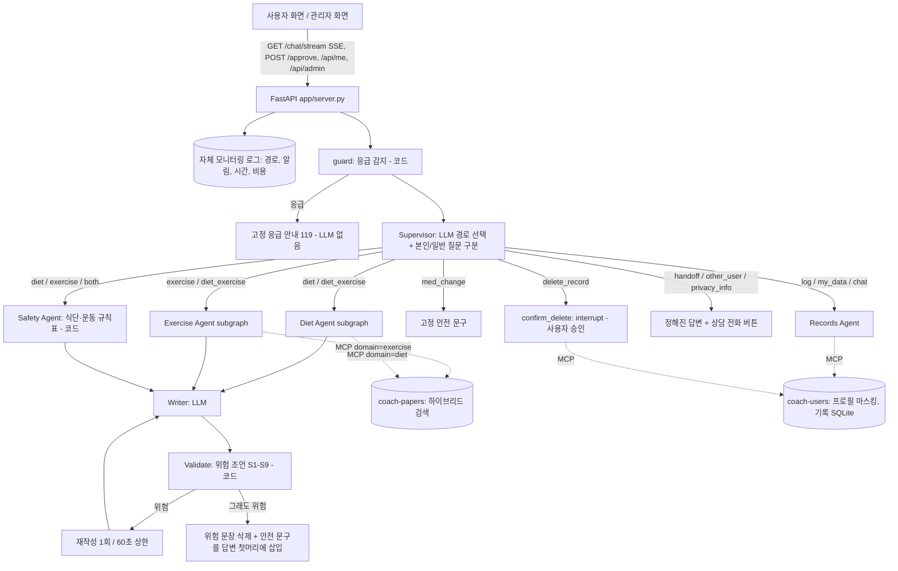

# 구조

Diet / Exercise Agent subgraph (당뇨 PoC 최종 모델과 같은 파이프라인, `domain`만 다름 — 혼합 질문은 두 subgraph가 병렬, 결과는 `evidence[domain]`에 따로 저장):
`make_queries`(검색어 chain 4회: 핵심 표현·step-back·질환/약별·정보 단위 분해, 코드 검사 + 1회 재시도) → `retrieve_mcp`(MCP `search_papers`: dense + BM25 RRF, 다른 대상 논문 제외) → `pick_notes`(검색어마다 top 10 중 2개 고르고 메모, LCEL batch 병렬) → `verify_notes`(메모가 보여 준 passage에 없는 단어가 있으면 버림).

## 모듈
| 경로 | 역할 |
|---|---|
| `coach/graph.py` | supervisor 그래프 조립 (노드·조건부 edge·병렬 fan-out·HITL checkpointer), 비교용 단일 Agent 그래프 `build_single_agent_graph` |
| `coach/agents/supervisor.py` | guard(응급), supervisor(경로 선택 + 본인·일반 질문 구분), 고정 응답 |
| `coach/agents/evidence.py` | Diet / Exercise Agent subgraph (`evidence_node(domain)`) |
| `coach/agents/safety_agent.py` | Safety Agent (규칙표, 코드) |
| `coach/agents/writer.py` | Writer, Validate, 재시도·삭제 |
| `coach/agents/records.py` | Records Agent, 삭제 승인(interrupt) |
| `coach/agents/prompts.py` | 모든 프롬프트 (목표 + 작업을 구체적으로) |
| `coach/safety/rules.py` | 응급 패턴, 식단·운동 안전 규칙표, 위험 조언 정의 S1–S9 |
| `coach/retrieval/` | PMC XML 파싱, 청킹, 하이브리드 index |
| `coach/deps.py` | 의존성 주입 Container (설정·LLM·MCP 서버) |
| `coach/llm.py` | LLM 인터페이스: OpenAI(LCEL invoke/batch) / FakeLLM(테스트) + token·비용 집계 |
| `coach/runner.py` | Multi-Agent·Single-Agent(그래프)·표준 RAG 실행 + 지연·비용 |
| `mcp_servers/papers_server.py`, `user_server.py` | MCP 서버 2개 (in-process 또는 stdio) |
| `app/server.py` | FastAPI: 채팅(SSE), 승인, 사용자·관리자 API |
| `web/index.html`, `web/admin.html` | 사용자 화면(채팅 중심, 내 정보는 펼칠 때만), 관리자 화면(전체 사용자, 알림, 사용자별 상세, 그래프) |
| `coach/tracelog.py` | 자체 모니터링 로그 (이름 없이 사용자 ID, 경로, 알림, 시간, 비용; 90일 보관) |
| `scripts/seed_demo_monitoring.py` | 관리자 화면 데모 데이터 (평가 답변 재생 + 가상 기록) |
| `eval/` | 평가셋, Before/After 실행, 채점, 그래프 |
| `tests/` | 단위 테스트 (FakeLLM + 가짜 MCP 서버, 네트워크 없음) |
