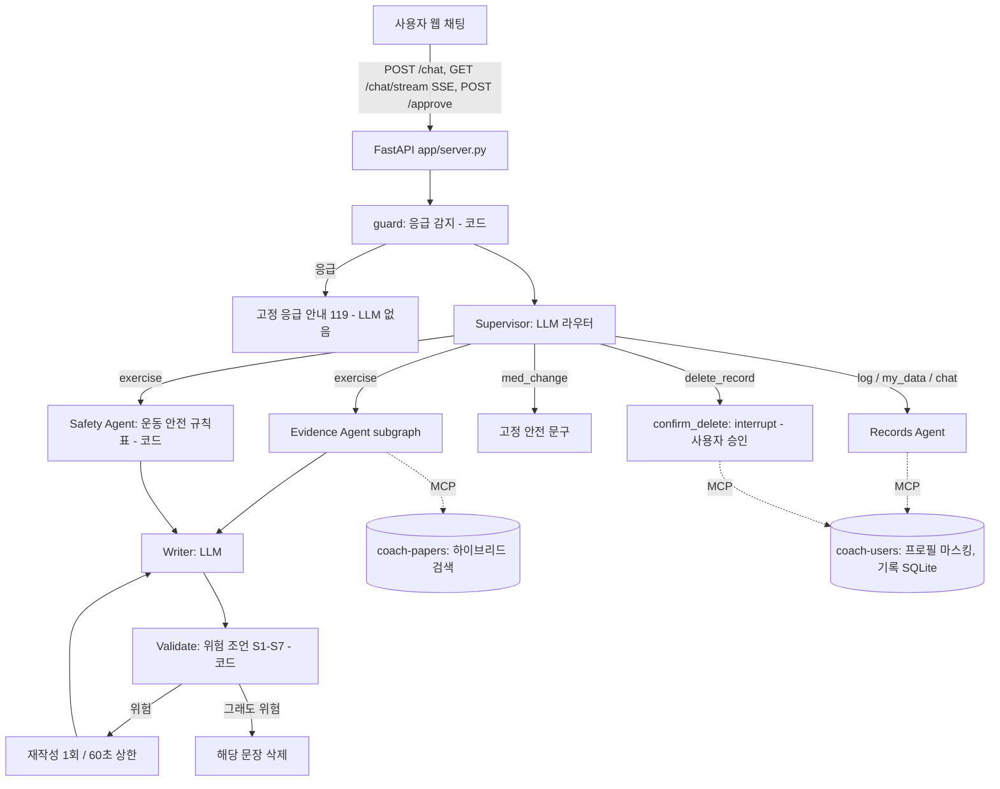

# 구조

Evidence Agent subgraph (당뇨 PoC 최종 모델과 같은 파이프라인):
`make_queries`(검색어 chain 4회: 핵심 표현·step-back·질환/약별·정보 단위 분해, 코드 검사 + 1회 재시도) → `retrieve_mcp`(MCP `search_papers`: dense + BM25 RRF, 다른 대상 논문 제외) → `pick_notes`(검색어마다 top 10 중 2개 고르고 메모, LCEL batch 병렬) → `verify_notes`(메모가 보여 준 passage에 없는 단어가 있으면 버림).

## 모듈
| 경로 | 역할 |
|---|---|
| `coach/graph.py` | supervisor 그래프 조립 (노드·조건부 edge·병렬 fan-out·HITL checkpointer) |
| `coach/agents/supervisor.py` | guard(응급), supervisor(라우터), 고정 응답 |
| `coach/agents/evidence.py` | Evidence Agent subgraph |
| `coach/agents/safety_agent.py` | Safety Agent (규칙표, 코드) |
| `coach/agents/writer.py` | Writer, Validate, 재시도·삭제 |
| `coach/agents/records.py` | Records Agent, 삭제 승인(interrupt) |
| `coach/agents/prompts.py` | 모든 프롬프트 (목표 + 작업을 구체적으로) |
| `coach/safety/rules.py` | 응급 패턴, 운동 안전 규칙표, 위험 조언 정의 S1-S7 |
| `coach/retrieval/` | PMC XML 파싱, 청킹, 하이브리드 index |
| `coach/deps.py` | 의존성 주입 Container (설정·LLM·MCP 서버) |
| `coach/llm.py` | LLM 인터페이스: OpenAI(LCEL invoke/batch) / FakeLLM(테스트) + token·비용 집계 |
| `coach/runner.py` | After(그래프)·Before(표준 RAG) 실행 + 지연·비용 |
| `mcp_servers/papers_server.py`, `user_server.py` | MCP 서버 2개 (in-process 또는 stdio) |
| `app/server.py`, `web/index.html` | FastAPI + SSE 웹 채팅 |
| `eval/` | 평가셋, Before/After 실행, 채점, 그래프 |
| `tests/` | 단위 테스트 (FakeLLM + 가짜 MCP 서버, 네트워크 없음) |
