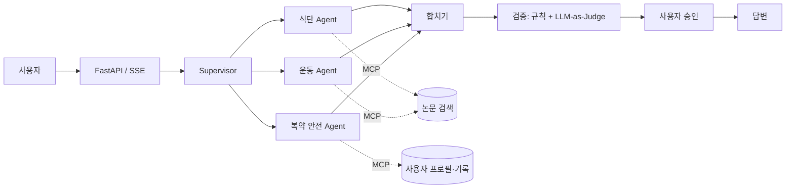

# 결과 보고서 — health-coach-multi-agent

> 고령 당뇨 환자를 위한 근거 기반 식단·운동·복약 안전 코칭 Multi-Agent
> 상태: 작성 중 (개발과 함께 갱신)

## 1. 문제
- 대상과 상황:
- 기존 방식(단일 RAG Agent)의 한계:

## 2. 해결 방법 개요
- 핵심 목표:
- 전체 구조:

## 3. 주요 기능
| 기능 | 설명 | 구현 위치 |
|---|---|---|
| 멀티 에이전트 라우팅 | | |
| 근거 기반 답변 (RAG) | | |
| 복약 안전 점검 | | |
| 식사·혈당 기록 | | |
| Human-in-the-loop 승인 | | |
| 실시간 진행 표시 (SSE) | | |

## 4. 개선 포인트
| 영역 | 무엇을 바꿨나 | 왜 |
|---|---|---|
| 그래프 구조 | | |
| MCP 서버 분리 | | |
| 검색 정확도 | | |
| 답변 검증 | | |
| 모듈화·테스트 | | |
| 개인정보 | | |
| Context 관리 | | |

## 5. Before / After
- 비교 대상: Before = , After =
- 같은 입력:

| 지표 | Before | After | 차이 |
|---|---|---|---|
| 검색 정확도 (Recall@6) | | | |
| 답변 정확도 | | | |
| 평균 지연시간 / p95 | | | |
| 질문당 비용 | | | |
| 검증 재작성 횟수 | | | |

## 6. 실패 사례

## 7. 한계와 trade-off

## 8. 추가 개선 사항

## 9. 실행 방법
