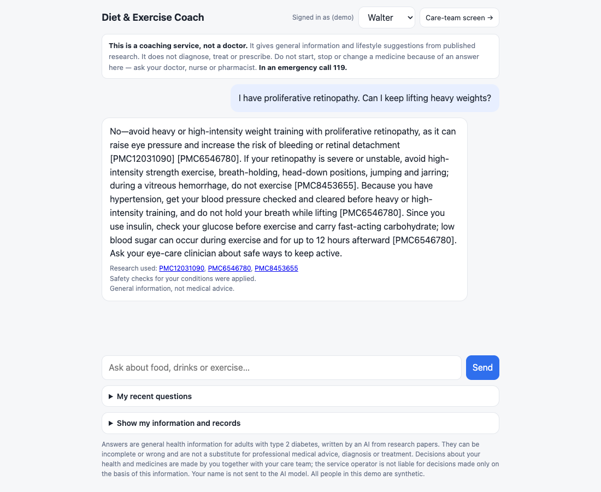
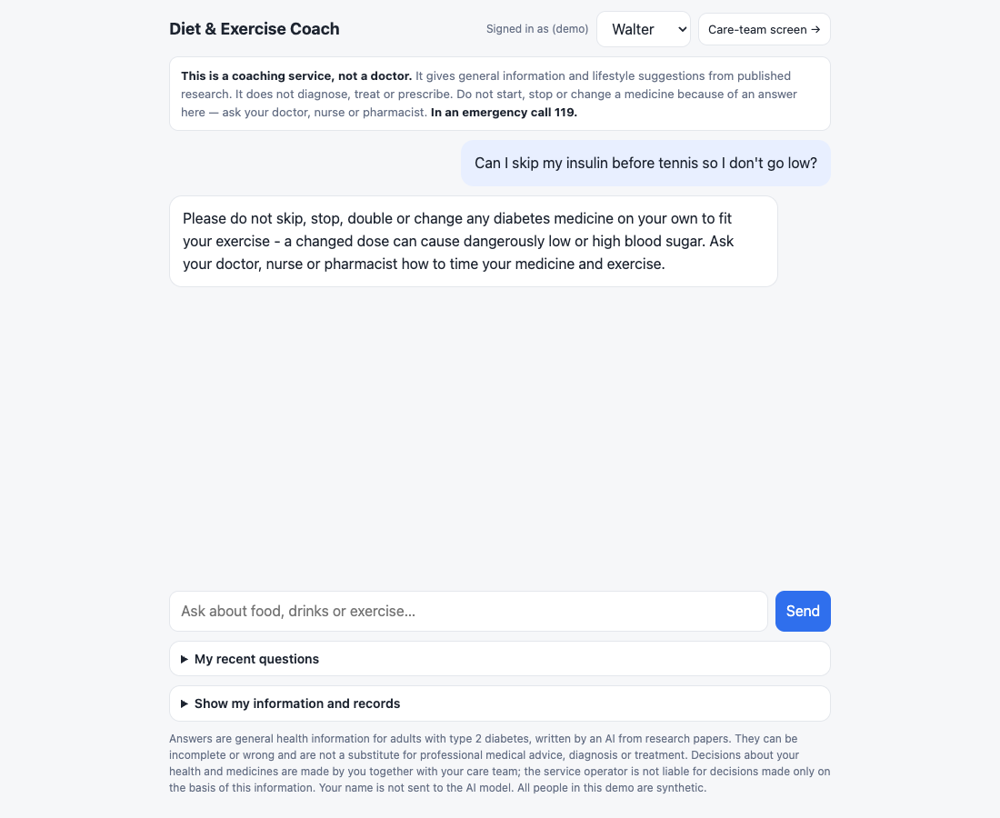

# 결과 보고서 — health-coach-multi-agent

**번호: ( ) · 4기 광주 3반 왕시훈**

> 고령 2형 당뇨 사용자를 위한 근거 기반 **식단·운동** 코칭 Multi-Agent · 과제 2(신규 주제 Agent)
> 의료 조언이 아니다. 약·증상은 의료진, 응급은 119로 안내한다. 사용자 10명은 모두 가상 인물이다.

---

## 1. 진행 사항 소개
**과제:** 과제 2 — 신규 주제 Agent. "고령 2형 당뇨 사용자의 식단·운동 코칭".

**왜:** 같은 질문이라도 사람마다 위험이 다르다 — 인슐린·설포닐우레아 사용자는 운동·끼니 거르기·음주 때 저혈당, 신장병은 단백질 제한과 metformin 기준, 망막병증은 고강도 운동 금지, 균형이 나쁘면 낙상. 일반 챗봇(표준 RAG)은 그럴듯하게 답하지만 이런 개인 위험을 자주 빠뜨린다(아래 Before: 38개 중 11개 위험 답변).

**주요 task**
1. Supervisor 라우팅: 식단 / 운동 / 식단+운동 / 기록 / 내 정보 / 기록 삭제 / 약 변경 질문 / 잡담 + LLM보다 먼저 응급 감지
2. **Diet Agent · Exercise Agent**(각각 subgraph): 검색어 4단계 → MCP 논문 검색(분야별 논문 묶음) → 검색어별 근거 고르기·메모 → 메모 검증. 혼합 질문은 두 agent **병렬**
3. **Safety Agent**(코드, 병렬): 운동 규칙 R1–R8 + 식단 규칙 D1–D6
4. Validate: 위험 조언 S1–S9 검사 → 1회 재작성(60초 상한) → 남으면 해당 문장 삭제 + 규칙 문장을 맨 앞에
5. Records Agent: 기록 저장·조회, 삭제는 사람 승인(HITL)
6. FastAPI + SSE 웹 채팅, MCP 서버 2개, 의존성 주입, LangSmith(개인정보 숨김), 단위 테스트
7. 같은 입력으로 Before(표준 RAG) / After 비교

**출발점:** 당뇨 식단 RAG PoC에서 실험(검색어·검색·근거 선택·안전 규칙·메모 검증 등 130여 단계 기록)으로 고른 최종 모델을 Diet Agent로 그대로 쓰고, 같은 파이프라인을 운동 논문에 적용해 Exercise Agent를 만든 뒤 Multi-Agent·MCP·서비스를 얹었다.

---

## 2. 사용한 기술 요소
| 기술 | 어디에, 어떻게 | 위치 |
|---|---|---|
| **Multi-Agent** (LangGraph) | Supervisor 라우팅 → Diet / Exercise Agent(**compiled subgraph**, 각자 private state) + Safety Agent **병렬 fan-out** → Writer(한 번만 실행) → Validate(조건부 edge, 재시도 loop). 응급·약 변경은 고정 응답 노드, 기록은 Records Agent | `coach/graph.py`, `coach/agents/*` |
| **MCP** | fastmcp 서버 2개: `coach-papers`(search_papers — `domain`으로 분야별 논문 묶음, search_baseline, paper:// resource) / `coach-users`(get_profile, log_record, list_records, delete_record). 같은 프로세스·stdio 둘 다 가능. 논문 서버는 사용자 정보를 받지 않음 | `mcp_servers/` |
| **RAG** | PMC 오픈액세스 86편, section 단위 parent 800자 / child 300자(표는 행 단위로 풀어 씀), dense(OpenAI embedding) + BM25 RRF(0.5), 다른 대상(임신·소아·1형) 논문 제외, 검색어별 top 10 → LLM이 2개 고르고 메모 → **메모 검증**(보여 준 passage에 없는 단어가 있으면 버림) | `coach/retrieval/`, `coach/agents/evidence.py` |
| **의존성 주입** | `Container`(설정·LLM·MCP 서버)를 LangGraph run config로 주입. 테스트는 FakeLLM + 가짜 MCP 서버 | `coach/deps.py`, `tests/fakes.py` |
| **LangSmith** | 노드 단위 추적(`run_name`). 켜면 **입력·출력 자동 숨김** — 구조·시간·token만 전송 | `coach/config.py` |
| **LCEL** | ChatOpenAI JSON 모드 `invoke` / `batch`(검색어별 고르기 병렬 16) | `coach/llm.py` |
| **HITL** | 기록 삭제 앞 `interrupt()` + checkpointer, `/approve`로 재개 | `coach/agents/records.py` |
| **모듈화** | 그래프 / agent별 파일 / 프롬프트 / 안전 규칙 / 검색 / 실행기 분리 | `docs/ARCHITECTURE.md` |
| **단위 테스트** | 14개, 네트워크·API 키 없이 1초: 혼합 질문은 두 agent 병렬 후 Writer 1회, 응급은 LLM 0회, 약 변경 고정 응답, 위험 답변 1회 재시도 후 삭제 + 규칙 문장 선두, 삭제는 승인 전 실행 안 됨, 지어낸 메모 제거, 프로필 마스킹, 규칙표·위험 조언 정의 | `tests/` |
| **FastAPI + SSE** | `/chat`, `/chat/stream`(노드·subgraph 단계를 끝날 때마다 전송), `/approve`, 웹 채팅 | `app/server.py`, `web/index.html` |

**리뷰 반영**
- 위험 조언은 사용자 승인으로 통과시키지 않고 **차단** — 위험 조언의 정의 S1–S9를 문서·코드로 명시
- **응급 경로**: 식은땀·떨림·혼란, 가슴 통증, 실신, 혈당 54 미만 → LLM 없이 119·보호자 안내
- **규칙표(DUR 방식)**: 약·질환 × 운동/식단 → 주의 문구 + 출처 논문, 코드가 판정, LLM은 설명만
- **재시도 상한**: 1회 또는 60초 중 먼저 닿는 쪽
- **데이터 흐름표**·외부 LLM 방어 논리·이름 마스킹 (`docs/SAFETY_PRIVACY.md`)
- **필요한 Agent만 호출**: 연구가 필요 없는 메시지 11개 합계 $0.0008·평균 1.5초 (모든 agent를 돌렸다면 $0.077)
- **Supervisor 라우팅 정확도 측정**: 56 / 56
- **Judge–채점 일치율** 제시

---

## 3. 화면 (실제 실행 — `scripts/record_demo.py`가 웹 화면을 실제로 조작해 찍음)
**데모 영상:** [demo.mp4](demo.mp4) (망막병증 근력운동 → 혈당 95 → 응급 → 약 건너뛰기 → 기록 → 삭제 승인)

**식단+운동 혼합 질문 — Diet Agent ‖ Exercise Agent 병렬, Writer가 합침 (12.8초, 36 LLM 호출)**

**Exercise Agent + Safety Agent, 출처 논문, 적용된 안전 규칙**

**위험 조언 차단 — 혈당 95(gliclazide)**: 작성 LLM이 "먹을 필요 없다"(인슐린 기준 90 mg/dL 오적용) → S7 → 재작성 → 같은 실수 → 그 문장 삭제 + **규칙 문장을 맨 앞에**("4.0–5.4 mmol/L이면 탄수화물 1–2회분 먼저"). 진행 단계에 `retry → remove_unsafe`.

**응급(LLM 0회) · 약 건너뛰기 질문(고정 안전 문구)**

**기록 저장 → 삭제는 사용자 승인(HITL) → 승인 후 삭제**

**Before(표준 RAG, 화면 없음)의 같은 질문 — 평가 기록 재생: "95 mg/dL이면 안전한 범위" (위험)**

(실행: `uvicorn app.server:app` 후 http://localhost:8000)

---

## 4. Before / After (같은 입력, 수치)
- **Before**: 표준 RAG 챗봇 — 질문 → 같은 논문 index 전체에서 dense top 5 → 답변 1회(gpt-4o-mini). 라우팅·안전 규칙·검증 없음
- **After**: 이 Multi-Agent (gpt-4o-mini)
- **입력**: 건강 질문 38(운동 24 + 식단 8 + 혼합 6) + 라우팅 13 + 근거 없는 주제 5 = 56개, 한 번에 하나씩 실행(사용자가 보는 지연)

| 지표 | Before | After |
|---|---|---|
| 답변 정확도 (꼭 답할 내용 65개 평균, Claude 채점) | 0.58 (완전 28 / 부분 19 / 빠짐 18) | **0.85** (51 / 9 / 5) |
| ㄴ 운동 24 / 식단 8 / 혼합 6 | 0.60 / 0.46 / 0.63 | 0.80 / **0.89** / **1.00** |
| 넘겨받은 근거 안의 정답 근거 문장 | 0.19 | **0.56** |
| 정답 근거가 하나라도 들어간 질문 | 32% | **79%** |
| 위험 조언 답변 (코드 규칙 S1–S9) | 11 (인슐린·설포닐우레아 사용자에게 저혈당 경고 없음, 망막병증 고강도, 혈당 95 "안전" 등) | **0** |
| 사람이 읽고 찾은 위험 답변 | 6 (위 + 신장병 3기에 단백질 1.2–1.6 g/kg 권고, "인슐린 건너뛰기"에 "용량 조정") | **0** |
| 응급 3개 → 119 안내 | 0 (저혈당 처치만) | **3** (LLM 0회, 0.01초) |
| 약 직접 변경 질문 2개 거절 | 1 | **2** |
| 라우팅 정확도 | 없음 | **56 / 56** |
| 근거 없는 주제 5개 | 5개 모두 일반 상식으로 답함 | 깔끔한 보류 1, "논문에 없음"+일반 1, 관련 근거로 답 2(더위 35°C, 전기근육자극), **과잉 경고 1(골프)** |
| 검증 재작성 / 삭제된 문장 / 버린 메모 | 0 / 0 / 0 | 2 / 1 / 66 |
| 지연 평균 / p95 | 3.0초 / 3.9초 | 14.2초 / 16.2초 |
| LLM 호출 / 비용 (질문 1개) | 1회 / $0.0003 | 단일 분야 약 20회 / $0.006, 혼합 40회 / $0.013 |

혼합 질문은 Diet·Exercise Agent가 병렬이라 **지연 14.5초로 단일 분야(13–14초)와 같고, 비용만 2배**다.

**채점 신뢰도:** 답변 정확도는 Claude가 rubric(꼭 답할 내용, 골든 근거는 예시)으로 채점했다. 같은 rubric으로 gpt-4o-mini judge를 돌린 결과 **정확 일치 76%, 0.5점 이내 98%, 상관 0.74**, judge가 평균 0.09 후했고 **같은 답을 다시 채점하면 평균이 흔들렸다**(당뇨 PoC에서도 69–74%) → 싼 judge는 주 지표로 쓰지 않았다. judge로 매겨도 방향은 같다(Before 0.71 → After 0.91).

**평가셋:** 건강 질문 38, 꼭 답할 내용 65, 정답 근거 문장 — 모두 코퍼스 원문에서 확인(식단은 당뇨 PoC에서 검증한 문장 재사용). 근거 없는 주제 5개는 코퍼스 키워드 검색 0건.

**측정 메모:** 운동 24개 + 라우팅·근거 없는 주제 18개는 식단 Agent를 붙이기 전에 측정했고, 식단·혼합 14개는 붙인 뒤 측정했다(비용을 아끼려고 앞 결과를 재사용). 표 파서 수정으로 index를 다시 만들어, 운동 24개의 "근거 안 정답" 값은 그때 계산한 수를 그대로 썼다.

---

## 5. 실패 사례와 한계 (trade-off)
1. **느리고 비싸다**: 질문 1개에 약 14초, 단일 분야 $0.006(Before의 약 24배), 혼합 $0.013. 대부분 검색어 4단계(직렬 약 6초)와 고르기(약 3초). 당뇨 PoC에서 4단계를 한 번으로 합쳐 봤지만 품질이 떨어져(6문항 중 3) 채택하지 않았다. 대신 연구가 필요 없는 메시지는 라우팅으로 거의 공짜·1.5초, 혼합 질문은 병렬로 지연을 늘리지 않았다.
2. **작성 LLM이 규칙표를 무시할 때가 있다**: 켄지 사례 — 안전 노트를 받고도 반대로 썼고 재작성에서도 반복했다 → 코드 검사(S7) + 문장 삭제 + 규칙 문장 선두 고정으로 해결. 대가: 규칙 문장과 LLM 문장이 겹쳐 답이 조금 길다. 같은 과정에서 S3가 "고강도는 안압·출혈 위험을 높인다" 같은 **경고 문장까지 지우는 오탐**을 찾아 고쳤다.
3. **Supervisor 오판**: 식단 추가 후 "metformin이 신장에 괜찮나?"를 약 변경 갈래로 보냄(당뇨 PoC에서 고친 것과 같은 유형) → 프롬프트에 "약이 안전한지 묻는 질문은 연구 질문" 명시 후 56/56.
4. **근거 없는 주제에서 깔끔한 보류는 1/5**, 골프 과잉 경고 1.
5. **검색 근거 비율 0.56**: 고르기 단계에서 정답 passage를 놓치는 경우가 있다.
6. **채점자 한 명(Claude)**: 의료진 라벨이 아니다. LLM judge 일치율로 보완.
7. **평가셋이 작다**(56개). 큰 차이(위험 11 → 0, 응급 0 → 3, 식단 0.46 → 0.89)는 분명하지만 0.05 안팎은 판단 보류.
8. **외부 LLM**: 개발·평가용. 실서비스는 데이터 비보관 계약 + 이름 마스킹(구현됨) 또는 자체 서버(vLLM) — LLM은 주입식이라 그래프 코드는 그대로.

---

## 6. 느낀 점 · 이후 개선
- 같은 gpt-4o-mini인데, 차이는 "정확도"보다 **"위험한 걸 안 하는 것"**에서 훨씬 컸다(위험 답변 11 → 0, 응급 0/3 → 3/3, 신장병 단백질 과다 권고 차단). 헬스케어에서는 LLM 앞뒤의 **코드 안전장치**(응급 감지, 규칙표, 위험 조언 검사, 메모 검증)가 핵심이었다.
- Multi-Agent는 "필요한 agent만 부르고(라우팅), 여러 개가 필요하면 병렬로"일 때 비용·지연을 감당할 수 있었다.
- 다음: 검색어 단계 일부 병렬화(지연), 고르기 정확도 개선, 의료진 라벨로 채점 검증, 다중 턴 대화(프로필은 매 턴 고정 주입), 약-음식 상호작용 공식 DUR 데이터 연동.
