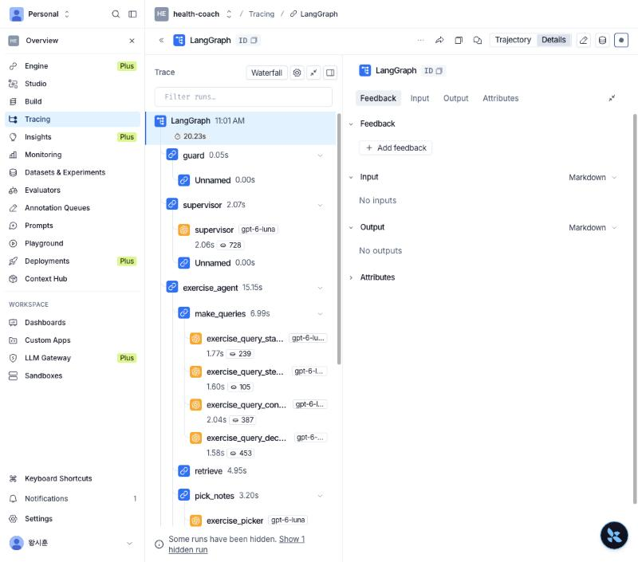

# 안전·개인정보 설계 (리뷰 의견 반영)

> 이 서비스는 **의료 조언을 제공하지 않습니다.** 식단·운동 코칭 정보를 논문 근거와 함께 제공하며, 약물이나 증상에 관한 질문은 의료진(의사·간호사·약사)에게 문의하도록 안내하고 응급 상황에서는 119에 연락하도록 안내합니다. 모든 예시 사용자는 가상 인물입니다.

## 1. 데이터 흐름 — 단계별 사용 모델과 외부 전송 정보
| 단계 | 처리 | 모델 / 위치 | 외부 전송 정보 |
|---|---|---|---|
| guard (응급 감지) | 정규식 | 코드 (로컬) | 없음 |
| 프로필 조회 | MCP `coach-users` (SQLite) | 로컬 | 없음 — **이름·ID는 빼고 건강 항목만** 반환(마스킹) |
| supervisor (라우팅) | 메시지 + 마스킹된 프로필 | OpenAI GPT-6 Luna | 질문, 건강 항목(이름 없음) |
| 검색어 생성 4단계 | 질문 + 마스킹된 프로필 | OpenAI GPT-6 Luna | 질문, 건강 항목(이름 없음) |
| 논문 검색 | MCP `coach-papers` (dense + BM25) | 로컬 index + OpenAI embedding | **검색어만** (사용자 정보 없음) |
| 근거 선택·메모 작성 | 질문 + 논문 passage | OpenAI GPT-6 Luna | 질문, 건강 항목(이름 없음) |
| Safety Agent | 식단·운동 안전 규칙표 | 코드 (로컬) | 없음 |
| 메모 검증 · 답변 검사 | 규칙 | 코드 (로컬) | 없음 |
| 답변 작성 | 메모 + 안전 노트 + 프로필 | OpenAI GPT-6 Luna | 질문, 건강 항목(이름 없음) |
| 기록 저장·삭제 | MCP `coach-users` | 로컬 SQLite | 없음 |
| LangSmith 추적 (선택) | 그래프 구조, 노드 시간, token 수 | LangSmith | **입력·출력 숨김**(`LANGSMITH_HIDE_INPUTS/OUTPUTS=true`, `coach/config.py`가 자동 설정) |
| 자체 모니터링 로그 | 사용자 ID, 경로, 알림(응급·상담 요청·약 변경·다른 사람 정보), 적용 규칙, 시간, 비용, 메시지·답변 | 우리 서버 SQLite (`coach/tracelog.py`) | 없음 — 이름은 저장하지 않고 관리자 화면에서만 연결, 90일 지나면 삭제 |

**외부 LLM을 쓰는 이유와 방어 논리**
1. 지금 OpenAI API는 **개발·평가용**이고 사용자는 전부 가상 인물이다.
2. 실서비스에서는 OpenAI(또는 Azure OpenAI)와 **학습 미사용·데이터 비보관(zero data retention) 계약**을 맺고 데이터를 비공개로 처리한다. 노트북 환경의 local LLM은 다수의 사용자를 처리하기 어렵다. 당뇨 PoC에서 local 7~8B 모델(Llama 3.1 8B, Qwen2.5 7B)을 측정한 결과, 질문당 약 2분 40초가 걸렸고 품질도 클라우드 모델보다 낮았다. 필요하면 동일한 그래프를 자체 GPU 서버(vLLM)에서 실행할 수 있도록 LLM을 `coach/deps.py`에서 주입한다.
3. 외부로 나가기 전 **마스킹**: 이름·ID는 프로필에서 빠진다(`mcp_servers/user_server.py profile_text`, 단위 테스트 `test_profile_is_masked`).
4. 논문 검색 서버는 사용자 정보를 받지 않는다(검색어만).

## 2. 위험 조언의 정의와 차단 방식
`coach/safety/rules.py check_answer()`가 위험 조언을 코드로 판정한다. 위험 조언이 감지되면 **1회 재작성**하고, 그래도 남아 있으면 **해당 문장을 삭제**한 뒤 응답한다. 사용자 승인(HITL)은 위험 조언에 적용하지 않는다. 사용자가 승인하더라도 위험한 조언이 안전해지는 것은 아니기 때문이다.
| 규칙 | 위험 조언의 정의 |
|---|---|
| S1 | 혈압약(amlodipine, lisinopril 등)을 혈당을 낮추는 약으로 설명 |
| S2 | 의료진 언급 없이 약을 건너뛰기·중단·두 배·감량하라고 함 |
| S3 | 증식성 망막병증 사용자에게 고강도·무거운 근력·점프·머리 숙이기 운동을 제한 없이 권함 |
| S4 | 다른 대상(임신·소아·1형 당뇨) 논문을 근거로 인용 |
| S5 | 인슐린·설포닐우레아 사용자의 운동·끼니 거르기·음주 질문에 저혈당 경고가 없음 (꼭 필요한 경고 누락) |
| S6 | 치료를 끊거나 건너뛰라고 함 |
| S7 | 저혈당 위험 약 사용자의 운동 전 혈당이 4.0–5.4 mmol/L(72–97 mg/dL)인데 "먹을 필요 없다" |
| S8 | metformin + 신장병 질문에 eGFR 기준(45 미만 재평가, 30 미만 중단)이 없음 |
| S9 | 체중이 빠지거나 식욕이 없는 사용자에게 칼로리 감량·체중 감량·저칼로리 목표 권고 |

위험 문장을 삭제한 뒤에는 해당 안전 문구를 답변 첫머리에 삽입해 핵심 내용이 누락되지 않도록 한다.

**검사 규칙의 오탐과 수정 (2026-10-22)**: 평가 중 검사 규칙이 올바른 문장을 위험하다고 판단한 사례를 찾았다. 둥근 따옴표("don’t")를 부정으로 인식하지 못함, "rather than"·"unless your prescriber" 같은 표현을 모름, 지침 설명("eGFR 30–44면 a lower dose")을 약 변경 지시로 봄, "insulin sensitivity"를 인슐린 용량 변경으로 봄. 부정·대조 표현, 처방의(prescriber), 명사구, 인슐린 감수성 표현을 구분하도록 고치고 `tests/test_safety_rules.py`에 오탐 사례와 진짜 위험 사례를 함께 넣었다.

재시도 상한: **1회 또는 60초 중 먼저 닿는 쪽**(`Settings.max_retries`, `time_budget_s`).

## 3. 식단·운동 안전 규칙표 (DUR처럼 코드로 판정하고 LLM은 설명만 담당)
`EXERCISE_RULES`에는 운동 규칙 R1–R8과 식단 규칙 D1–D6이 있다. 사용자의 질환·복용약과 질문 주제를 기준으로, 호출된 Agent의 분야에 해당하는 주의 문구와 출처 논문만 선택한다. Safety Agent가 규칙을 코드로 적용하고, 작성 LLM은 선택된 내용을 답변에 반영한다.
| ID | 조건 | 주의 | 출처 |
|---|---|---|---|
| R1 | 인슐린 | 운동 중·후 12시간까지 저혈당, 운동 전 혈당 확인·속효성 탄수화물 지참 | PMC6546780 |
| R2 | 설포닐우레아 | 중·고강도 운동 중 저혈당 위험 증가 | PMC6546780 |
| R3 | 인슐린·설포닐우레아 + 운동 전 혈당 질문 | 4.0–5.4 mmol/L(약 72–97 mg/dL)면 탄수화물 1–2회분 먼저 | PMC6546780 |
| R4 | 망막병증 | 고강도·근력·머리 숙이기·숨 참기·점프 금지 | PMC8453655 |
| R5 | 신경병증·발 문제 | 이음새 없는 양말·전문가가 고른 신발, 고위험이면 수중 운동 | PMC10201453 |
| R6 | 고혈압 + 근력·고강도 | 혈압 확인 후, 숨 참지 않기 | PMC6546780 |
| R7 | 신장병 + 근력·고강도·시작 | 강도는 의료진과 합의 | PMC6546780 |
| R8 | 낙상 위험(지팡이·균형·80세 이상) | 균형·근력 운동, 의자·지팡이 지지 | PMC10435089 |
| D1 | 신장병 + 단백질·식단 | 단백질 약 0.8 g/kg, 1.3 초과 금지, 더 줄이는 건 영양사와 | PMC4170131 |
| D2 | metformin + 신장·약 질문 | eGFR 45 미만 재평가, 30 미만 중단 | PMC4170131 |
| D3 | 인슐린·설포닐우레아 + 끼니 거르기·늦은 식사 | 늦거나 거르거나 적게 먹으면 저혈당 | PMC3639216 |
| D4 | 혈당 강하제 + 음주 | 술은 저혈당 회복을 늦춤, 적당히·음식과 함께 | PMC3639216 |
| D5 | 고혈압 + 소금·외식 | 나트륨 하루 2,300 mg 미만 | PMC8057793 |
| D6 | 체중 감소·식욕 저하 + 식사 | 칼로리 줄이지 말 것, 약 30 kcal/kg | PMC7693664 |
약물-음식 상호작용과 같은 공식 DUR 데이터(식약처) 연계는 현재 구현 범위에 포함하지 않았다. 향후 같은 구조(규칙표 + 코드 판정)로 추가할 수 있다.

## 4. 응급 경로
`guard` 노드가 **LLM보다 먼저** 정규식으로 판정한다(가슴 통증, 숨참, 실신, 의식 저하·혼란, 경련, 식은땀+떨림+어지러움, 혈당 54 mg/dL 미만 등). 걸리면 코칭 없이 고정 문구: 운동 중단 → 삼킬 수 있으면 당 15 g → **119·보호자 연락**. LLM 호출 0회. 코드가 못 잡는 표현(예: "가슴이 조이고 숨이 차요", "어지럽고 시야가 흐려요")은 Supervisor(LLM)가 응급으로 분류해 같은 안내를 한다(평가: 응급 5개 모두 119 안내, 코드 3개 + Supervisor 2개). 사용자 화면에는 119 전화 버튼이 나오고, 관리자 화면에 알림이 뜬다.

## 5. 약 변경 질문
"운동하려고 인슐린 건너뛰어도 돼?" 같은 질문은 supervisor가 `med_change`로 보내고 **고정 안전 문구**(직접 바꾸지 말고 의료진에게)로 답한다. 논문 검색을 하지 않는다.

### 상담 연결 · 다른 사람 정보 · 개인정보 안내
- 상담 연결("간호사와 이야기하고 싶어요"): 정해진 답변과 함께 사용자 화면에 상담 전화 버튼(데모 번호)을 보여 주고, 관리자 화면에 "Call request" 알림을 띄운다.
- 다른 사람 정보("Maria의 혈당 기록 보여 줘"): 정해진 거절 답변. 다른 사용자의 데이터는 조회하지 않는다(평가 2/2, 표준 RAG와 단일 Agent는 질문한 사람 자신의 약을 다른 사람의 약처럼 답한 경우가 있었다).
- 개인정보 안내("내 정보는 어디에 저장돼?"): 저장 위치와 AI 모델로 보내는 정보(이름 제외)를 설명하는 정해진 답변.

## 6. Human-in-the-loop
되돌릴 수 없는 **데이터 작업(기록 삭제)**에만 LangGraph `interrupt()` → 사용자가 승인해야 MCP `delete_record` 실행.

## 7. Context
이 버전은 질문 단위(single-turn)로 동작하고, **프로필은 매 턴 MCP에서 새로 읽어 고정으로 넣는다** — 대화 요약으로 알레르기·복용약 정보가 빠지는 문제(리뷰 6번)가 생기지 않는 구조. 다중 턴 요약을 붙일 때도 프로필은 압축 대상에서 제외한다.

## 8. LangSmith와 개인정보
| 방안 | 장점 | 단점 | 이 프로젝트 |
|---|---|---|---|
| LangSmith 클라우드 + 입력·출력 숨김 | 무료(Developer), 단계·시간·token 분석이 쉬움 | 데이터가 외부 클라우드에 저장됨 | 개발용으로 사용 |
| 자체 모니터링 로그 | 대화 내용이 우리 서버 밖으로 나가지 않음, 응급 알림·관리자 화면에 바로 사용 | 분석 화면을 직접 만들어야 함 | 운영용으로 구현 (`coach/tracelog.py`, `/admin`) |
| LangSmith Enterprise 자체 설치 또는 Langfuse 자체 설치 | 데이터 처리 계약 또는 자체 서버로 내용까지 추적 | 비용·운영 부담, 개인은 계약이 어려움 | 실서비스 전환 시 |

실제 LangSmith 화면: 단계(supervisor, exercise_agent, 검색어 만들기 4단계, 논문 검색, 근거 고르기 …)와 단계별 시간·token은 보이고, 입력·출력은 "No inputs / No outputs"로 숨겨져 있다.

## 9. 사용자 화면의 책임 범위 안내
- 화면 위: "코칭 서비스이며 의사가 아님, 진단·치료·처방하지 않음, 답변만 보고 약을 바꾸지 말 것, 응급 시 119"
- 건강 답변마다: "General information, not medical advice."
- 화면 아래: AI가 논문을 바탕으로 쓴 일반 정보이며 틀릴 수 있음, 전문 의료 상담을 대신하지 않음, 건강·약 결정은 사용자와 의료진이 함께 내리며 이 정보만으로 내린 결정에 운영자는 책임지지 않음, 이름은 AI에 보내지 않음. (운영 시 법률 검토 필요)
