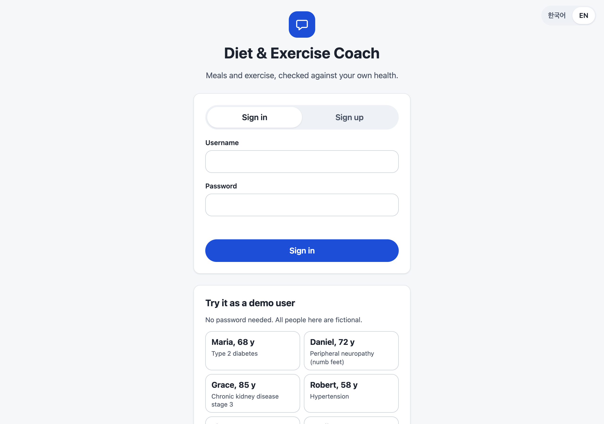
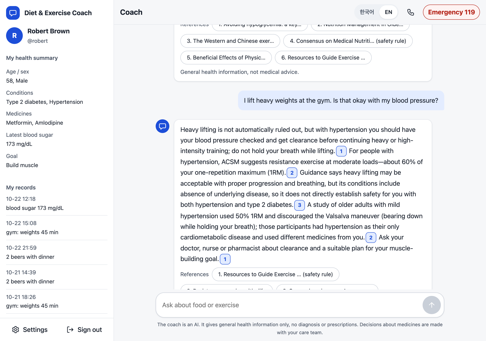
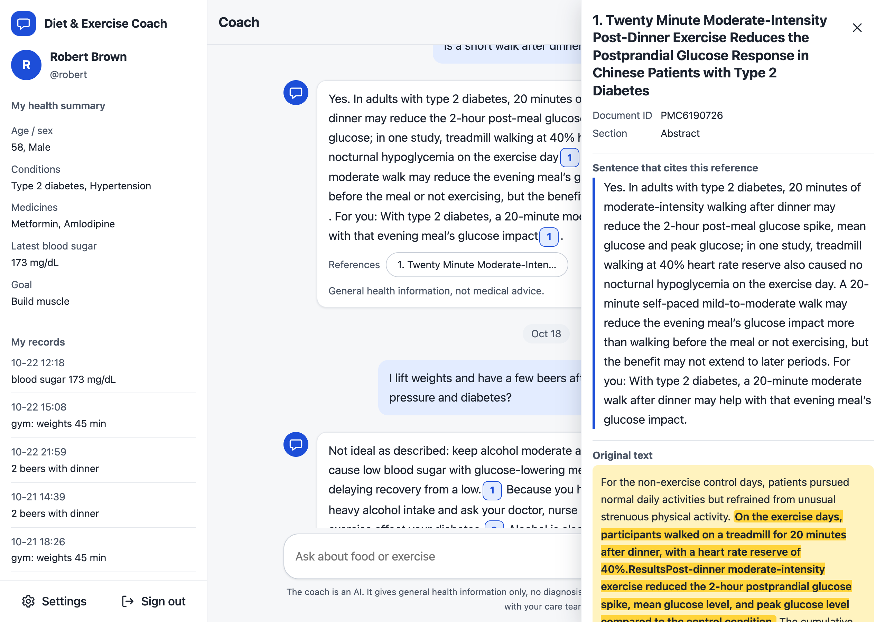
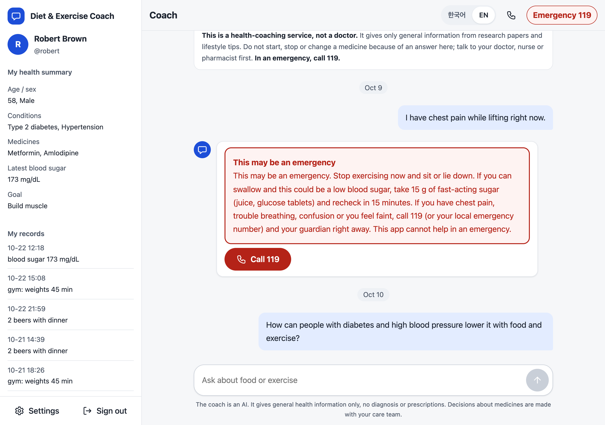
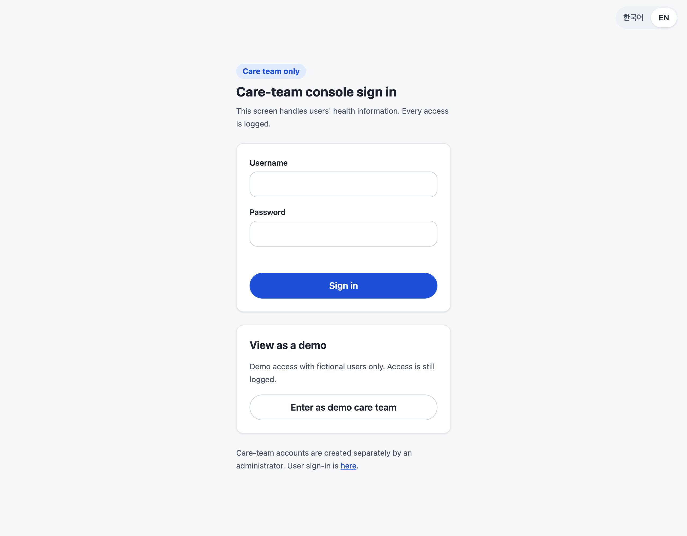
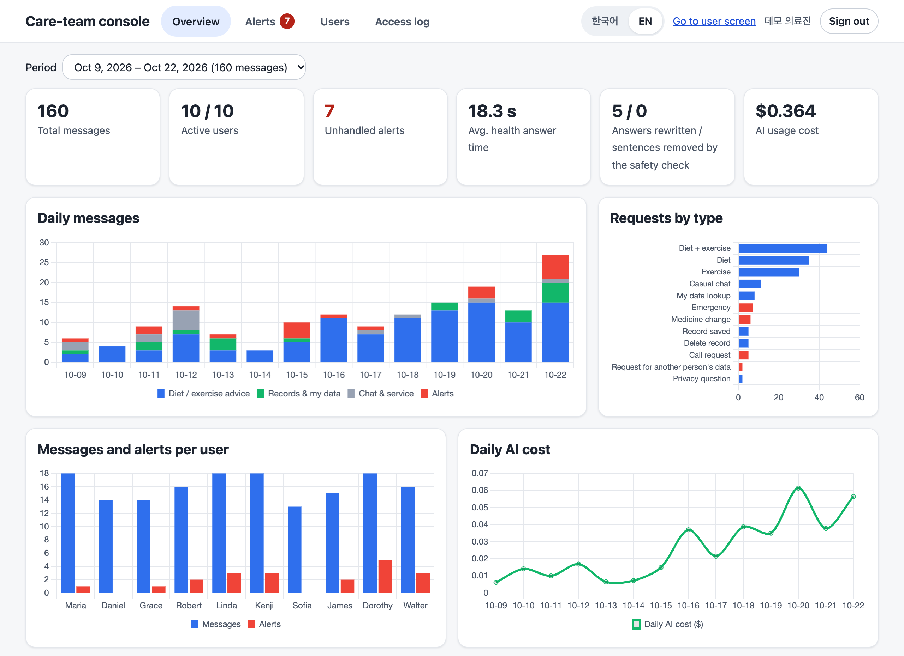
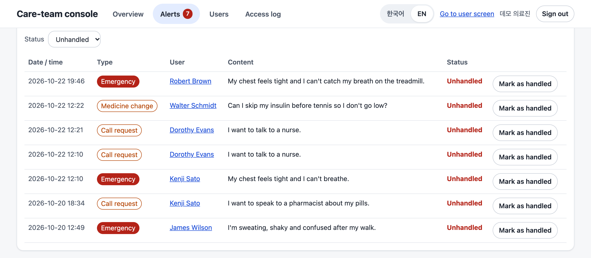
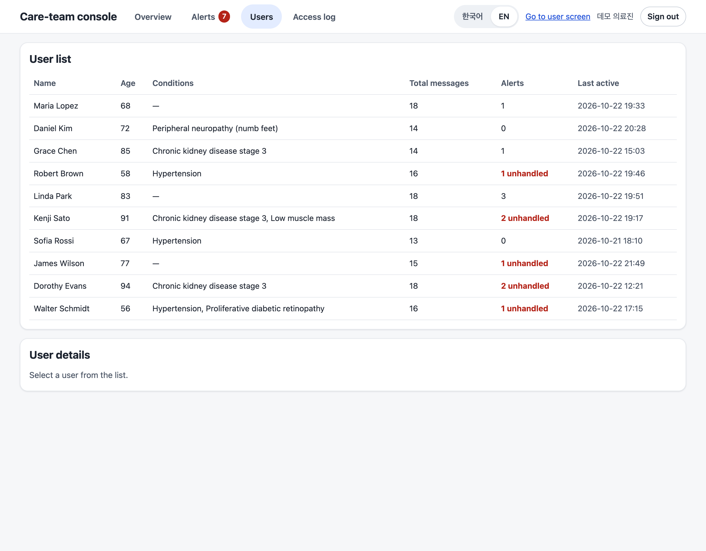
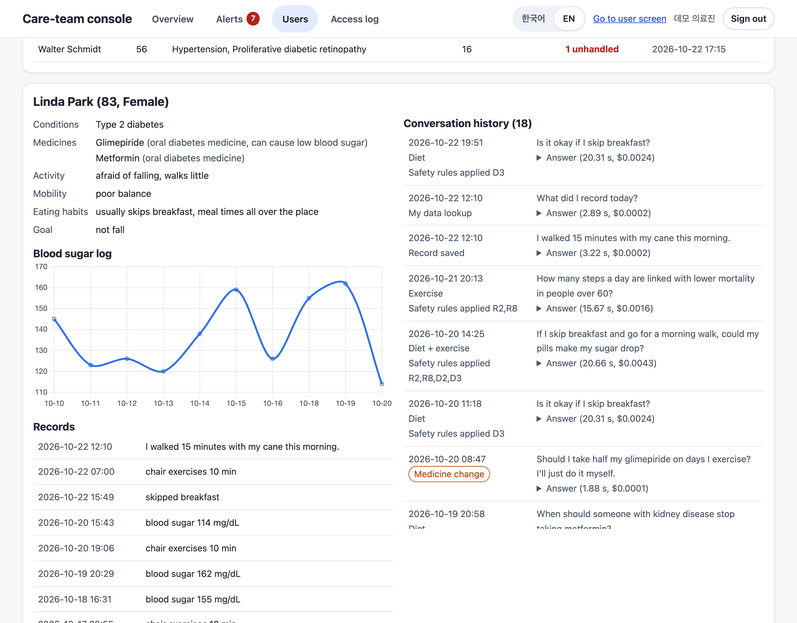

# 화면 모음

가상 사용자의 저장된 데모 기록 화면입니다(실시간 답변 아님). 설명은 [README](../../README.md#서비스-화면)에 있고, `scripts/ui_screenshots_readme.py`로 다시 만들 수 있습니다.

## 이용자 로그인

| 한국어 | English |
|:---:|:---:|
|  |  |

## 채팅 답변과 근거 칩

| 한국어 | English |
|:---:|:---:|
|  |  |

## 근거 패널

| 한국어 | English |
|:---:|:---:|
|  |  |

## 응급 안내

| 한국어 | English |
|:---:|:---:|
|  |  |

## 의료진 로그인

| 한국어 | English |
|:---:|:---:|
|  |  |

## 의료진 콘솔 개요

| 한국어 | English |
|:---:|:---:|
|  |  |

## 의료진 콘솔 알림

| 한국어 | English |
|:---:|:---:|
|  |  |

## 의료진 콘솔 이용자 목록

| 한국어 | English |
|:---:|:---:|
|  |  |

## 의료진 콘솔 이용자 상세

| 한국어 | English |
|:---:|:---:|
|  |  |

## 모바일

| 채팅 | 근거 패널 | 큰 글자 | 영어 |
|:---:|:---:|:---:|:---:|
|  |  |  |  |
